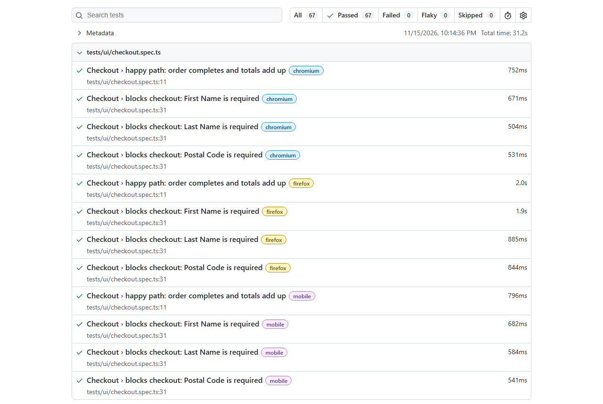

# 🧪 QA Playground

End-to-end UI and API test automation with **Playwright + TypeScript**, run against two public practice targets:

- **UI:** [saucedemo.com](https://www.saucedemo.com), a demo shop
- **API:** [Restful Booker](https://restful-booker.herokuapp.com), a demo booking API

[](https://github.com/lprvy/qa-playground/actions/workflows/playwright.yml) [](LICENSE)

📊 **[Latest test report](https://lprvy.github.io/qa-playground/)**: the Playwright HTML report from the most recent run on `main` (every push and every night), with each test's steps, timings and, for failures, screenshots and traces.

<p align="center"><a href="https://lprvy.github.io/qa-playground/"></a></p>

## What's inside

| | |
|---|---|
| **67 tests** | login, sorting, cart, checkout, full API lifecycle |
| **3 browsers** | Chromium, Firefox and a Pixel 7 mobile viewport |
| **Page Object Model** | `pages/` keeps selectors out of the tests |
| **Custom fixtures** | `loggedIn` fixture skips the login boilerplate |
| **Negative testing** | empty forms, wrong passwords, SQL-ish input, missing checkout fields, requests without auth |
| **Bug reports** | [BUGS.md](BUGS.md): 4 bugs found and written up, each guarded by a test |
| **CI** | GitHub Actions on every push + nightly; the HTML report is [published to GitHub Pages](https://lprvy.github.io/qa-playground/) |

## Known-bug tests

`tests/ui/known-bugs.spec.ts` describes the **correct** behaviour and marks each test with `test.fail()`. The suite stays green while the bug exists, and **turns red the day the bug is fixed**. That's the signal to close the ticket and turn it into a normal regression test.

## Run it

```bash
npm install
npx playwright install --with-deps chromium firefox
npm test              # everything
npm run test:ui       # UI, Chromium only
npm run test:api      # API only
npm run report        # open the HTML report
```

## Structure

```
pages/            Page objects (LoginPage, InventoryPage, CheckoutPage)
tests/ui/         UI specs + fixtures
tests/api/        API specs (Playwright request context)
BUGS.md           Bug reports
```

## License

MIT
